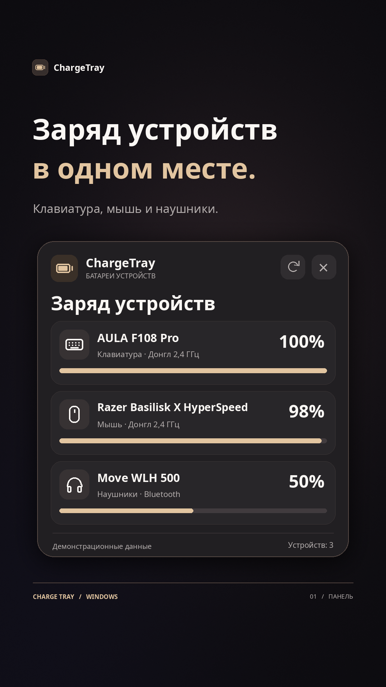

> **ChargeTray 2.2 Preview — Device Intelligence:** новый Multi-Source Engine (Windows/HID + опциональный локальный Vendor Bridge), раздел Protocol Lab с безопасным сравнением состояний до/после, источник данных в карточках и исправленная светлая тема с цветными RGB-пресетами. Фирменные адаптеры производителей пока требуют отдельной реализации и проверки. [Что нового](RELEASE-NOTES-2.2.0.md).

> **ChargeTray 2.1.5:** обнаружение USB/HID `062A:38CC` (комбинированный ресивер клавиатуры/мыши) и `A8A5:2255` (семейство мышиных YJX-ресиверов). Улучшена диагностика `1D57:FA60`, включая отчёт `030040F30A` с неподтверждённым кодом состояния F3. **Обнаружение устройства не гарантирует чтение батареи.** [Подробнее](RELEASE-NOTES-2.1.5.md).

> **2.1.3 Preview — питание AULA F108 Pro:** ChargeTray определяет проводное USB-подключение и показывает осторожное «⚡? Вероятно заряжается», когда процент батареи последовательно растёт. Это **не подтверждённый аппаратный статус**. При зарядке от розетки точное обнаружение невозможно без сигнала от самой клавиатуры. RGB и все прежние функции сохранены. [Подробнее](RELEASE-NOTES-2.1.3.md).

> **ChargeTray 2.1 — Windows 11 Fluent Edition:** новая боковая навигация, пять разделов Device Hub, Fluent-переключатели, тёмная/светлая темы, системный акцент и плавная RGB-анимация без кнопки обновления. Прежняя подсветка сохранена. [Что нового](RELEASE-NOTES-2.1.md).

# ChargeTray

[**Скачать ChargeTray для Windows**](https://github.com/DrowzyX/ChargeTray/releases/latest) · [**Сообщить об ошибке / предложить устройство**](https://github.com/DrowzyX/ChargeTray/issues)


*Демонстрационное превью приложения.*

**Заряд мыши, клавиатуры, наушников и геймпада в одном месте.**

ChargeTray — утилита для Windows 10/11 x64. Она показывает состояние аккумуляторов в трее, на полоске рядом с часами или в компактном островке у верхнего края экрана. Островок раскрывается при наведении, а по клику открывает панель с устройствами и подробностями.

## Новое в ChargeTray 2.0

- **Device Hub:** правый клик по значку в трее → «Центр устройств (Windows 11)». Открывается отдельная тёмная панель с вкладками **Устройства, История, Настройки**.
- **Профили:** переименовывайте мыши и клавиатуры, закрепляйте важные устройства первыми, задавайте индивидуальный порог уведомления 1–99%.
- **Dynamic Island 2.0:** выбор монитора, краткое раскрытие при появлении/отключении устройства или низком заряде, сохранены прежние анимации и поведение при наведении.
- **История заряда:** локальные измерения с ограничением 30 дней, графики и осторожный приблизительный прогноз при достаточной статистике.
- **Обновления:** проверка GitHub Releases и скачивание архива по запросу; **установка остаётся ручной**.
- **Совместимость:** расширяемый локальный каталог VID:PID; имя неизвестного устройства определяется без выдуманного процента.
- **RGB-подсветка интерфейса сохранена:** те же цвета, пресеты и плавная RGB-анимация из 1.4, с отдельным режимом экономии.

Настройки и история лежат в \x60%LOCALAPPDATA%\\ChargeTray\x60 и не отправляются автоматически. Каталог дополнительных имён — \x60device-profiles.json\x60 в той же папке. Профиль идентификации **не даёт** доступ к неизвестному протоколу батареи.

## Что умеет

- **Три режима отображения.** Островок сверху, полоска у часов или только трей. Режим можно сменить через контекстное меню.
- **Быстрый просмотр.** Островок показывает до четырёх актуальных показаний. Полная панель показывает доступные устройства и способы подключения. При полноэкранном режиме островок скрывается.
- **Уведомления о низком заряде.** Для устройств с процентами порог — ниже 15%. Для контроллеров, которые сообщают только низкий уровень, выводится статус без выдуманного процента. На каждое устройство уведомление не повторяется, пока уровень не восстановится.
- **Автоматическое обновление.** Обычно подключённые устройства проверяются раз в 20 секунд. Частота обращения к батарее зависит от устройства. Нажмите **↻** или **F5**, чтобы обновить данные вручную.
- **Автозагрузка по желанию.** Правый клик по значку → **Запускать вместе с Windows**. По умолчанию опция выключена.
- **Оформление и RGB.** Правый клик по значку → **Оформление и RGB**: выберите любой оттенок, один из пресетов или плавную RGB-анимацию. Цвета применяются к панели, островку и полоске; они **не управляют аппаратной подсветкой мыши или клавиатуры**. Настройки сохраняются между запусками.
- **Два уровня диагностики.** Краткий отчёт показывает список устройств без повторяющихся строк Windows, а расширенный отчёт для разработчика включает VID:PID, HID usage page, размеры входных/выходных/feature-отчётов и результат опроса. Это помогает исследовать новые модели, но не гарантирует чтения заряда. Данные никуда не отправляются автоматически.
- **Обратная связь.** Через меню **Диагностика и поддержка → Сообщить о новом устройстве** можно открыть GitHub Issues.

## Скриншоты интерфейса

Программа показывает заряд подключённой периферии в единой панели и в компактном островке сверху экрана.

| Панель ChargeTray | Островок (Dynamic Island) |
| :---: | :---: |
|  |  |

*Эти изображения — демонстрационные визуализации. Фактические показания зависят от подключённых устройств.*

## Совместимость

| Устройства | Что поддерживается | Статус |
| --- | --- | --- |
| **AULA F108 Pro** | USB‑ресивер 2,4 ГГц `05AC:024F` с именем `F108Pro Dongle` | Чтение подтверждено |
| **Razer Basilisk X HyperSpeed** | USB‑ресивер 2,4 ГГц `1532:0083` | Чтение подтверждено |
| **Move WLH 500** | Bluetooth | Чтение подтверждено |
| **Другие мыши Razer** | Добавлены 30 дополнительных USB‑ID ресиверов, в том числе для серий Basilisk, Viper, DeathAdder, Naga, Orochi, Cobra и Pro Click | Реализовано по известным протоколам. Проверка каждого варианта на реальном устройстве ещё не выполнена |
| **Мыши, клавиатуры и наушники по Bluetooth** | Устройства, которые передают заряд Windows или через стандартный Bluetooth LE Battery Service | Зависит от устройства, прошивки и драйвера |
| **Xbox и совместимые геймпады** | Windows Gaming Input, при необходимости XInput | Процент или общий уровень, в зависимости от устройства |
| **Ноутбуки и планшеты Windows** | Системный аккумулятор, если Windows сообщает его заряд | Зависит от данных Windows |
| **Steam Controller Puck** | `28DE:1304` | Распознавание; для заряда нужен отдельный протокол |
| **ROCCAT Vulcan Pro** | `1E7D:30F7` | Распознавание проводной клавиатуры; аккумулятора может не быть |
| **Gaming Keyboard** | `258A:0049` | Распознавание; заряд пока не подтверждён |
| **Беспроводные мыши с ресивером `1D57:FA60`** | Идентификация без предположения о бренде, экспериментальное пассивное чтение | Работает только с совместимыми HID-отчётами |
| **ARDOR GAMING Fury ARDW-FURY3325-BK** | Точный VID:PID ещё не подтверждён | Требуется диагностика конкретного ресивера |

Полный перечень USB‑ID Razer см. в [таблице ресиверов](COMPATIBILITY.md). Наличие устройства в списке не означает, что заряд доступен **во всех режимах подключения**. Универсального чтения для любых USB‑донглов 2,4 ГГц нет. Если драйвер или прошивка не отдаёт доступное показание, ChargeTray не подставляет значение.

### Если AULA F108 Pro временно перестала отвечать

ChargeTray автоматически делает повторные попытки. Если только что было свежее показание, полная панель сохранит его до двух минут с пометкой **«Последнее показание»** и знаком **≈**. Сохранённое значение не попадает в краткий индикатор и не вызывает предупреждение о разряде. Как только донгл снова ответит, процент обновится без ручного нажатия **↻**.

## Установка

**Для автономного ChargeTray 2.0 под Windows x64 отдельная установка .NET не требуется:** необходимые компоненты включены в публикуемый EXE.

1. Перейдите в [Releases](https://github.com/DrowzyX/ChargeTray/releases/latest) и скачайте ZIP для Windows x64 из нужной версии (например, `ChargeTray-2.1.0-win-x64.zip`, когда версия опубликована).
2. Распакуйте **весь архив** в постоянную папку, например `C:\Apps\ChargeTray`.
3. Запустите `ChargeTray.exe`.
4. Найдите значок батареи рядом с часами Windows. Если он скрыт, откройте скрытые значки стрелкой **˄**.

ChargeTray не требует прав администратора для обычного запуска и не устанавливает системную службу. Для удобства можно включить автозагрузку через **правый клик по значку → «Запускать вместе с Windows»**. Если переносите EXE в другую папку, проверьте путь автозагрузки.

### Если Windows просит установить .NET

Для **автономной сборки** из актуального релиза этого происходить не должно. Проверьте, что скачали новый ZIP из Releases, а не старую сборку или архив исходников GitHub (**Source code**).

Для **предыдущих или неавтономных сборок** может потребоваться [.NET 10 Desktop Runtime x64](https://dotnet.microsoft.com/en-us/download/dotnet/10.0). Эту ссылку оставляем для совместимости со старыми версиями.

> **Важно:** приложение рассчитано на Windows x64. На Windows ARM64 и 32-битной Windows корректная работа этой сборки не гарантирована. Windows SmartScreen может показать предупреждение для новых неподписанных программ.

## Сообщить о проблеме или предложить устройство

Откройте **правый клик по значку → Диагностика и поддержка → Скопировать краткий отчёт**. Если заряд не определяется, используйте **Скопировать отчёт для разработчика** — он группирует интерфейсы по VID:PID и показывает HID-метаданные без серийных номеров и необработанных путей устройств. Перед публикацией проверьте, что имена устройств не содержат персональных сведений. Добавьте точную модель, способ подключения (Bluetooth, USB‑ресивер или кабель) и показание фирменного ПО, если оно доступно.

## Сборка из исходников

Для локальной сборки требуется .NET 10 SDK; для запуска автономной версии пользователю SDK не нужен.

```powershell
dotnet publish src/ChargeTray.csproj -c Release -r win-x64 --self-contained true -p:PublishSingleFile=true -p:IncludeNativeLibrariesForSelfExtract=true -o publish
dotnet run --project tests/BatteryLogic.Tests.csproj
```

В репозитории исходный код хранится в папке `src`, тесты — в `tests`, а настройки автоматической сборки — в `.github/workflows`. Готовый ZIP для пользователей размещается в разделе [Releases](https://github.com/DrowzyX/ChargeTray/releases). Артефакт из GitHub Actions может содержать внутренний ZIP — для публичного релиза загружайте архив с самой программой.

### Статус поддержки новых моделей

Определение устройства по `VID:PID` не означает, что можно получить уровень батареи. Поддержка `1D57:FA60` экспериментальная, а заряд Steam Controller, ROCCAT Vulcan Pro, Gaming Keyboard и ARDOR GAMING Fury пока не подтверждён. Подробности и требования к диагностике есть в [DEVICE-REPORTS.md](DEVICE-REPORTS.md).

## Настройка оформления

Через **Оформление и RGB** в контекстном меню выберите цвет (палитра Windows и HEX/RGB), один из шести пресетов или **Плавная RGB-анимация**. Анимация затрагивает только визуальные акценты интерфейса, не включает аппаратную подсветку устройств. В режиме RGB программа перерисовывает видимые окна с ограниченным интервалом, чтобы снизить расход ресурсов. Чтобы вернуться к стандартному графитовому стилю, нажмите **Сбросить оформление**.

## Оформление в версии 2.1

В **Центр устройств → Оформление** теперь доступны прежние цвета, пресеты и плавный RGB, автоматический акцент Windows, скорость цикла 5/9/18 секунд и выбор тёмной/светлой темы. На Windows 11 программа пытается использовать системные эффекты заголовка и скругления, на Windows 10 применяет обычное оформление без этих эффектов. RGB работает независимо от ручного обновления данных батареи. Экономичный режим отключает непрерывную анимацию, не стирая выбранный цвет.

В **Настройки → Dynamic Island** можно выбрать монитор и отступ сверху. Вкладки с классическим WinForms TabControl заменены боковой навигацией. Полный перечень изменений — [RELEASE-NOTES-2.1.md](RELEASE-NOTES-2.1.md).

Если в GitHub Releases для ZIP доступна проверенная сумма SHA-256, ChargeTray может после согласия пользователя установить новую версию с резервной копией текущего EXE. Если проверка недоступна, сохранена ручная установка. Автоматически и без подтверждения ничего не устанавливается.
