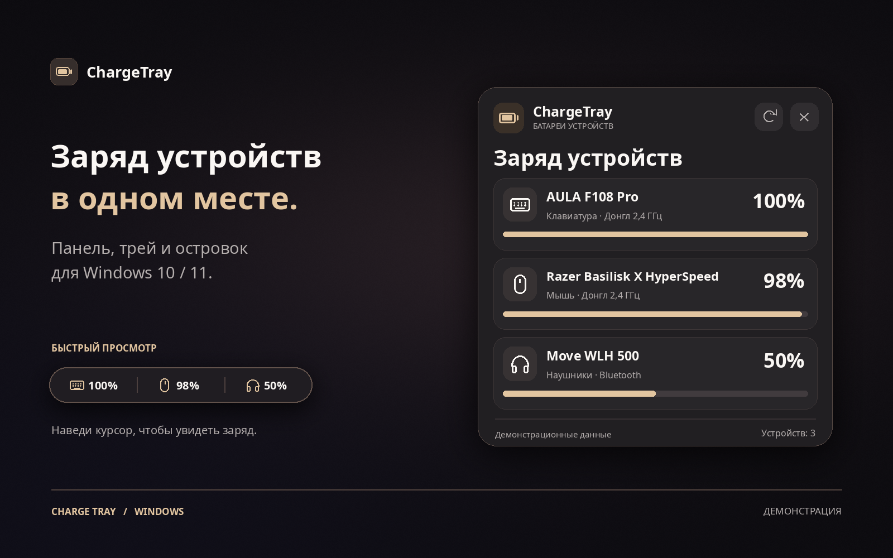

> **Версия 1.3:** добавлено распознавание дополнительных USB-устройств и экспериментальное чтение заряда совместимых ресиверов `1D57:FA60`. Готовая автономная сборка для Windows x64 доступна в [Releases](https://github.com/DrowzyX/ChargeTray/releases/latest). Подробности — в [DEVICE-REPORTS.md](DEVICE-REPORTS.md).

# ChargeTray

[**Скачать ChargeTray для Windows**](https://github.com/DrowzyX/ChargeTray/releases/latest) · [**Сообщить об ошибке / предложить устройство**](https://github.com/DrowzyX/ChargeTray/issues)



*Демонстрационное превью приложения.*

**Заряд мыши, клавиатуры, наушников и геймпада в одном месте.**

ChargeTray — утилита для Windows 10/11 x64. Она показывает состояние аккумуляторов в трее, на полоске рядом с часами или в компактном островке у верхнего края экрана. Островок раскрывается при наведении, а по клику открывает панель с устройствами и подробностями.

## Что умеет

- **Три режима отображения.** Островок сверху, полоска у часов или только трей. Режим можно сменить через контекстное меню.
- **Быстрый просмотр.** Островок показывает до четырёх актуальных показаний. Полная панель показывает доступные устройства и способы подключения. При полноэкранном режиме островок скрывается.
- **Уведомления о низком заряде.** Для устройств с процентами порог — ниже 15%. Для контроллеров, которые сообщают только низкий уровень, выводится статус без выдуманного процента. На каждое устройство уведомление не повторяется, пока уровень не восстановится.
- **Автоматическое обновление.** Обычно подключённые устройства проверяются раз в 20 секунд. Частота обращения к батарее зависит от устройства. Нажмите **↻** или **F5**, чтобы обновить данные вручную.
- **Автозагрузка по желанию.** Правый клик по значку → **Запускать вместе с Windows**. По умолчанию опция выключена.
- **Диагностика.** Через меню можно скопировать сведения об устройствах для сообщения о проблеме. Диагностические данные не отправляются автоматически.

## Скриншоты интерфейса

Программа показывает заряд подключённой периферии в единой панели и в компактном островке сверху экрана.

| Панель ChargeTray | Островок (Dynamic Island) |
| :---: | :---: |
|  |  |

*Эти изображения — демонстрационные визуализации. Фактические показания зависят от подключённых устройств.*

## Совместимость

| Устройства | Что поддерживается | Статус |
| --- | --- | --- |
| **AULA F108 Pro** | USB‑ресивер 2,4 ГГц `05AC:024F` с именем `F108Pro Dongle` | Чтение подтверждено |
| **Razer Basilisk X HyperSpeed** | USB‑ресивер 2,4 ГГц `1532:0083` | Чтение подтверждено |
| **Move WLH 500** | Bluetooth | Чтение подтверждено |
| **Другие мыши Razer** | Добавлены 30 дополнительных USB‑ID ресиверов, в том числе для серий Basilisk, Viper, DeathAdder, Naga, Orochi, Cobra и Pro Click | Реализовано по известным протоколам. Проверка каждого варианта на реальном устройстве ещё не выполнена |
| **Мыши, клавиатуры и наушники по Bluetooth** | Устройства, которые передают заряд Windows или через стандартный Bluetooth LE Battery Service | Зависит от устройства, прошивки и драйвера |
| **Xbox и совместимые геймпады** | Windows Gaming Input, при необходимости XInput | Процент или общий уровень, в зависимости от устройства |
| **Ноутбуки и планшеты Windows** | Системный аккумулятор, если Windows сообщает его заряд | Зависит от данных Windows |
| **Steam Controller Puck** | `28DE:1304` | Распознавание; для заряда нужен отдельный протокол |
| **ROCCAT Vulcan Pro** | `1E7D:30F7` | Распознавание проводной клавиатуры; аккумулятора может не быть |
| **Gaming Keyboard** | `258A:0049` | Распознавание; заряд пока не подтверждён |
| **Беспроводные мыши с ресивером `1D57:FA60`** | Идентификация без предположения о бренде, экспериментальное пассивное чтение | Работает только с совместимыми HID-отчётами |
| **ARDOR GAMING Fury ARDW-FURY3325-BK** | Точный VID:PID ещё не подтверждён | Требуется диагностика конкретного ресивера |

Полный перечень USB‑ID Razer см. в [таблице ресиверов](COMPATIBILITY.md). Наличие устройства в списке не означает, что заряд доступен **во всех режимах подключения**. Универсального чтения для любых USB‑донглов 2,4 ГГц нет. Если драйвер или прошивка не отдаёт доступное показание, ChargeTray не подставляет значение.

### Если AULA F108 Pro временно перестала отвечать

ChargeTray автоматически делает повторные попытки. Если только что было свежее показание, полная панель сохранит его до двух минут с пометкой **«Последнее показание»** и знаком **≈**. Сохранённое значение не попадает в краткий индикатор и не вызывает предупреждение о разряде. Как только донгл снова ответит, процент обновится без ручного нажатия **↻**.

## Установка

**Для актуального автономного релиза ChargeTray 1.3 под Windows x64 отдельная установка .NET не требуется:** необходимые компоненты включены в публикуемый EXE.

1. Перейдите в [Releases](https://github.com/DrowzyX/ChargeTray/releases/latest) и скачайте `ChargeTray-1.3-win-x64.zip`.
2. Распакуйте **весь архив** в постоянную папку, например `C:\Apps\ChargeTray`.
3. Запустите `ChargeTray.exe`.
4. Найдите значок батареи рядом с часами Windows. Если он скрыт, откройте скрытые значки стрелкой **˄**.

ChargeTray не требует прав администратора для обычного запуска и не устанавливает системную службу. Для удобства можно включить автозагрузку через **правый клик по значку → «Запускать вместе с Windows»**. Если переносите EXE в другую папку, проверьте путь автозагрузки.

### Если Windows просит установить .NET

Для **автономной сборки** из актуального релиза этого происходить не должно. Проверьте, что скачали новый ZIP из Releases, а не старую сборку или архив исходников GitHub (**Source code**).

Для **предыдущих или неавтономных сборок** может потребоваться [.NET 10 Desktop Runtime x64](https://dotnet.microsoft.com/en-us/download/dotnet/10.0). Эту ссылку оставляем для совместимости со старыми версиями.

> **Важно:** приложение рассчитано на Windows x64. На Windows ARM64 и 32-битной Windows корректная работа этой сборки не гарантирована. Windows SmartScreen может показать предупреждение для новых неподписанных программ.

## Сообщить о проблеме или предложить устройство

Откройте **правый клик по значку → Скопировать диагностику** и приложите в GitHub Issues только строки нужного устройства. Добавьте точную модель, способ подключения (Bluetooth, USB‑ресивер или кабель) и показание фирменной утилиты, если оно доступно. Для нестабильного чтения полезны два снимка диагностики: когда заряд отображается и сразу после пропадания.

## Сборка из исходников

Для локальной сборки требуется .NET 10 SDK; для запуска автономной версии пользователю SDK не нужен.

```powershell
dotnet publish src/ChargeTray.csproj -c Release -r win-x64 --self-contained true -p:PublishSingleFile=true -p:IncludeNativeLibrariesForSelfExtract=true -o publish
dotnet run --project tests/BatteryLogic.Tests.csproj
```

В репозитории исходный код хранится в папке `src`, тесты — в `tests`, а настройки автоматической сборки — в `.github/workflows`. Готовый ZIP для пользователей размещается в разделе [Releases](https://github.com/DrowzyX/ChargeTray/releases). Артефакт из GitHub Actions может содержать внутренний ZIP — для публичного релиза загружайте архив с самой программой.

### Статус поддержки новых моделей

Определение устройства по `VID:PID` не означает, что можно получить уровень батареи. Поддержка `1D57:FA60` экспериментальная, а заряд Steam Controller, ROCCAT Vulcan Pro, Gaming Keyboard и ARDOR GAMING Fury пока не подтверждён. Подробности и требования к диагностике есть в [DEVICE-REPORTS.md](DEVICE-REPORTS.md).
